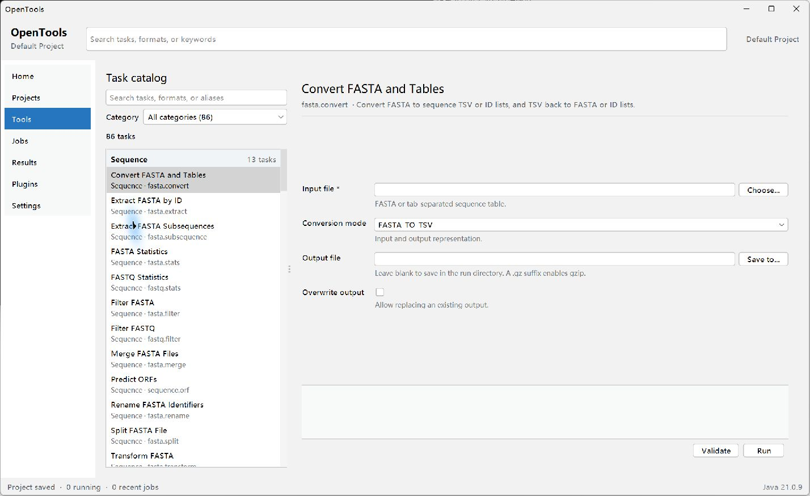

# OpenTools

English | [简体中文](README.zh-CN.md)

| | |
| :---: | :---: |
|  |  |

<p align="center">
  <a href="https://www.deepseek.com/"></a>
  <a href="https://openai.com/codex/"></a>
  <br>
  
</p>

OpenTools is a local-first, tool-driven bioinformatics workbench for Windows and
Java 21. It brings common sequence, annotation, table, alignment, expression,
enrichment, HTS, and visualization tools into one searchable workspace. The same
tool definitions power the desktop app, CLI, and MCP server.

The project is designed for bench scientists, bioinformatics analysts, and plugin
developers. Research data stays local by default. OpenTools is licensed under
GPL-3.0-or-later; bundled third-party programs retain their own licenses.

Most of this project was generated with the **DeepSeek** model, with **Codex**
and **DeepSeek Harness** as coding agents. DeepSeek Harness now maintains the
project; it is a development tool, not a runtime dependency, and release
packages contain no agent or model code.



## Features

- 93 built-in tools covering FASTA/FASTQ, GFF3/GTF, BED, tables, local and remote
  BLAST, DIAMOND, HMMER, multiple sequence alignment, phylogeny, comparative
  genomics, expression, enrichment, SAM/BAM/CRAM, VCF/BCF, and plotting.
- Projects, jobs, input hashes, parameters, logs, and result manifests are
  persisted together for reproducible reruns.
- Jobs run through a bounded queue with persisted progress, cooperative
  cancellation, and startup recovery for runs interrupted by an abnormal exit.
- Versioned GO/KEGG resource packs are imported once with counts and SHA-256
  digests, then reused by id; enrichment results record the resource version.
- Dependency-ordered workflows pass step artifacts into later steps through
  placeholders, with cycle checks and stop/continue failure policies.
- Collinearity plots use real GFF3/GTF gene order; SSR mining reports perfect
  microsatellite loci; primer check predicts amplicons with IUPAC-aware matching.
- MEME motif discovery and MAST scanning integrate with an installed MEME Suite;
  multi-genome collinearity links render as a chord/ribbon overview.
- GUI, CLI, and MCP share `ToolDescriptor`, validation, tool execution, and
  result contracts.
- The bundled default plugin adds an interactive Coin Runner tool whose
  completed run feeds the normal job and result pipeline.
- The in-app Docs view follows the active UI language and renders bundled
  Markdown fully offline.
- Java-native tools require no external executable. BLAST+, DIAMOND, HMMER,
  MEME/MAST, MUSCLE, trimAl, IQ-TREE, and MCScanX are available through external adapters.

## Quick links

| Entry | Description |
| --- | --- |
| [Downloads](#download) | Windows, Linux, and macOS portable packages with checksums |
| [User documentation](docs/en_US/README.md) | Quick start, tool reference, formats, CLI/MCP, FAQ |
| [CLI](docs/en_US/cli.md) | Discovery, validation, execution, jobs, and JSON output |
| [MCP](docs/en_US/mcp.md) | stdio and authenticated loopback HTTP |
| [Workflows](docs/en_US/workflow.md) | Dependency-ordered JSON workflows with artifact placeholders |
| [Plugin development](docs/en_US/plugin-development.md) | Plugin API, lifecycle, and examples |

## Download

The latest snapshot `0.10.1-SNAPSHOT` ships four portable packages. Every archive
has a matching `.sha256.json` checksum file in the same release.

| Platform | Package | Checksum |
| --- | --- | --- |
| Windows x64 | [opentools-0.10.1-SNAPSHOT-windows-x64.zip](https://github.com/R-Josef/OpenTools/releases/download/0.10.1-SNAPSHOT/opentools-0.10.1-SNAPSHOT-windows-x64.zip) | [sha256](https://github.com/R-Josef/OpenTools/releases/download/0.10.1-SNAPSHOT/opentools-0.10.1-SNAPSHOT-windows-x64.zip.sha256.json) |
| Linux x64 | [opentools-0.10.1-SNAPSHOT-linux-x64.tar.gz](https://github.com/R-Josef/OpenTools/releases/download/0.10.1-SNAPSHOT/opentools-0.10.1-SNAPSHOT-linux-x64.tar.gz) | [sha256](https://github.com/R-Josef/OpenTools/releases/download/0.10.1-SNAPSHOT/opentools-0.10.1-SNAPSHOT-linux-x64.tar.gz.sha256.json) |
| macOS x64 (Intel) | [opentools-0.10.1-SNAPSHOT-macos-x64.zip](https://github.com/R-Josef/OpenTools/releases/download/0.10.1-SNAPSHOT/opentools-0.10.1-SNAPSHOT-macos-x64.zip) | [sha256](https://github.com/R-Josef/OpenTools/releases/download/0.10.1-SNAPSHOT/opentools-0.10.1-SNAPSHOT-macos-x64.zip.sha256.json) |
| macOS arm64 (Apple Silicon) | [opentools-0.10.1-SNAPSHOT-macos-arm64.zip](https://github.com/R-Josef/OpenTools/releases/download/0.10.1-SNAPSHOT/opentools-0.10.1-SNAPSHOT-macos-arm64.zip) | [sha256](https://github.com/R-Josef/OpenTools/releases/download/0.10.1-SNAPSHOT/opentools-0.10.1-SNAPSHOT-macos-arm64.zip.sha256.json) |

[Browse all releases](https://github.com/R-Josef/OpenTools/releases) |
[Latest release](https://github.com/R-Josef/OpenTools/releases/latest)

Windows x64, Linux x64, macOS x64, and macOS arm64 are built by the platform
matrix in `.github/workflows/release.yml`. Installers, automatic updates, and
macOS Developer ID signing are not included yet. General JAR and
build-from-source details live in [release packages](docs/en_US/release-packages.md).

## First run

1. Download the package matching Windows, Linux, macOS Intel, or macOS Apple
   Silicon.
2. Extract the complete archive.
3. Start the GUI with `OpenTools.exe`, `bin/OpenTools`, or `OpenTools.app`.
4. Use `OpenToolsCLI.exe`, `bin/OpenToolsCLI`, or
   `OpenTools.app/Contents/MacOS/OpenToolsCLI` for terminals and MCP.
5. Open **Docs** from the main navigation at any time.

Building from source:

```powershell
$env:JAVA_HOME = '<JDK 21 installation directory>'
$env:Path = "$env:JAVA_HOME\bin;$env:Path"
mvn clean verify
```

See [Installation](docs/en_US/installation.md) and
[release packages](docs/en_US/release-packages.md) for details.

## External tools

Bundled tools are discovered from the package first. Developer builds may also
use explicit paths, `OPENTOOLS_*` variables, or `PATH`. Exact versions, official
URLs, checksums, licenses, source URLs, and build recipes are in the platform
manifests under [packaging](packaging/).

Third-party executables are independent programs and are not relicensed as
OpenTools. See [THIRD_PARTY_NOTICES.md](THIRD_PARTY_NOTICES.md) and the package
`licenses/` directory.

## Documentation

- [Language selector](docs/README.md)
- [English user guide](docs/en_US/README.md)
- [中文用户指南](docs/zh_CN/README.md)
- [Tool reference](docs/en_US/tool-reference.md)
- [UI and Docs development](docs/en_US/ui-and-docs.md)
- [Changelog](CHANGELOG.md)

The built-in Markdown browser defaults to the current UI language. `en_US` reads
from `docs/en_US`; Simplified Chinese (`zh_CN`) reads from `docs/zh_CN`.

## License

OpenTools is distributed under [GPL-3.0-or-later](LICENSE). Bundled third-party
programs keep their upstream licenses. Release maintainers must review the
license, source-offer, and runtime redistribution obligations for every update.
