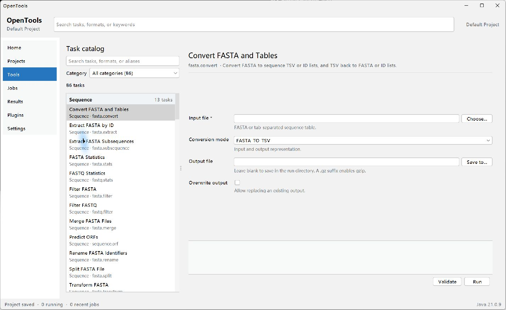

# OpenTools

[English](README.md) | 简体中文

OpenTools 是一个本地优先、任务驱动的开源生物信息学工作台。它把常用序列、
注释、表格、比对、表达、富集、HTS 和可视化任务放进同一个可搜索界面，并让
同一套任务定义同时服务于 Windows 桌面、CLI 和 MCP。

项目面向 Windows 科研用户、生物信息分析人员和插件开发者。数据默认留在本机，
不要求登录或上传。OpenTools 自身以 GPL-3.0-or-later 发布；随包分发的第三方
程序保留各自许可证，详见 [第三方声明](THIRD_PARTY_NOTICES.md)。



## 功能概览

- 86 个内置任务，覆盖 FASTA/FASTQ、GFF3/GTF、BED、表格、BLAST/DIAMOND、
  HMMER、多序列比对、系统发育、比较基因组、表达与富集、SAM/BAM/CRAM、
  VCF/BCF、统计图和交互式结果查看。
- 项目、作业、输入哈希、参数、日志和结果清单统一保存，可重试并复制等价 CLI 命令。
- GUI、CLI 和 MCP 共用 `ToolDescriptor`、参数校验、任务执行和结果模型。
- 内置 Docs 页面离线渲染用户文档，并为全部 86 个任务动态生成参数、范围、
  示例和失败边界说明。
- Java 原生任务可直接运行；BLAST+、DIAMOND、HMMER、MUSCLE、trimAl、
  IQ-TREE 和 MCScanX 通过外部工具适配器调用。

## 快速入口

| 入口 | 说明 |
| --- | --- |
| Windows 便携包 | `OpenTools.exe` / `OpenToolsCLI.exe`，自带精简 Java 运行时和 Windows x64 工具 |
| 通用 JAR | 面向已有 Java 21 和分析工具的用户，不捆绑平台二进制 |
| [应用内 Docs](docs/zh_CN/README.md) | 快速开始、分类任务、格式、CLI/MCP、FAQ |
| [CLI](docs/zh_CN/cli.md) | 任务发现、校验、运行、作业和 JSON 自动化 |
| [MCP](docs/zh_CN/mcp.md) | stdio 与仅限本机的认证 HTTP 接入 |
| [插件开发](docs/zh_CN/plugin-development.md) | Plugin API、生命周期和示例 |

## 发布包

OpenTools 采用分层发布：

1. **通用 JAR**：可在 Java 21 环境运行全部 Java 内置任务。外部工具从包内
   `tools/`、显式路径、环境变量或 `PATH` 发现，不包含任何平台二进制。
2. **Windows x64 便携整合包**：解压后通过 `OpenTools.exe` 启动，自带运行时和
   固定版本的 Windows 工具。目标是无需安装 Java、conda 或 MSYS2。

当前只正式构建 Windows x64 便携包。Linux 和 macOS 需要独立 CI、独立工具集和
独立验证，不能把其他平台二进制混入 Windows 包。签名、安装器和自动更新尚未包含。

## 安装与首次运行

### Windows x64 便携包

1. 下载 `opentools-0.8.0-SNAPSHOT-windows-x64.zip` 并解压到普通用户可写目录。
2. 双击 `OpenTools.exe`；终端使用 `OpenToolsCLI.exe`。
3. 首次启动会创建或打开本地项目。可从 Home 打开任务目录或 Docs。
4. 不要只复制 `OpenTools.exe`；运行时、应用和工具目录必须保持在同一发布目录。

### 通用 JAR

需要 JDK 21：

```powershell
java -jar opentools.jar
java -jar opentools.jar tools list
java -jar opentools.jar --project C:\work\project run fasta.stats `
  --param input=C:\data\genome.fa
```

源码构建：

```powershell
mvn clean verify
```

完整安装、升级和路径说明见 [安装与升级](docs/zh_CN/installation.md)。

## 外部工具

便携包优先从自身 `tools/` 目录发现工具。开发者版还可使用：

- 任务中的显式可执行文件或目录参数；
- `OPENTOOLS_BLASTN`、`OPENTOOLS_BLASTP`、`OPENTOOLS_MAKEBLASTDB`、
  `OPENTOOLS_DIAMOND`、`OPENTOOLS_HMMSCAN`、`OPENTOOLS_HMMSEARCH`、
  `OPENTOOLS_MUSCLE`、`OPENTOOLS_TRIMAL`、`OPENTOOLS_IQTREE` 和
  `OPENTOOLS_MCSCANX`；
- 系统 `PATH`。

Windows 开发环境在上述查找失败后还会检查固定目录
`C:\Program Files\OpenToolsDeps\bin`。该后备不会覆盖显式路径、`OPENTOOLS_*`
或 PATH，并会在 Settings 中明确提示；修改 PATH 后通常需要重启 Explorer 或重新
登录，才能让新启动的程序继承更新后的环境。

构建维护者从官方固定地址下载并校验 SHA-256，缓存后可离线复用。终端用户不需要
conda。第三方许可证、源码地址和构建信息见 `licenses/`、
[THIRD_PARTY_NOTICES.md](THIRD_PARTY_NOTICES.md) 与
[外部工具说明](docs/zh_CN/external-tools.md)。

## 许可证

OpenTools 使用 [GNU GPL v3.0 or later](LICENSE)。第三方可执行程序作为同一 ZIP
中的独立聚合程序分发，不改变其原有许可证，也不被重新许可为 GPL。发布包保留
逐项许可证、版权、来源、哈希和源码获取方式。具体兼容性与再分发义务仍应由发布
维护者在每次升级时进行人工法律复核。

## 文档

- [文档语言入口](docs/README.md)
- [用户文档首页](docs/zh_CN/README.md)
- [快速开始](docs/zh_CN/quick-start.md)
- [任务参考](docs/zh_CN/task-reference.md)
- [文件格式](docs/zh_CN/file-formats.md)
- [错误与退出码](docs/zh_CN/errors-exit-codes.md)
- [常见问题](docs/zh_CN/faq.md)
- [第三方开发者文档](docs/zh_CN/plugin-development.md)
- [变更记录](CHANGELOG.md)

应用内 `Docs` 页面读取随 JAR 和便携包一起分发 Markdown。文档渲染完全离线，
不执行 HTML、脚本或远程资源；外部链接只会交给系统浏览器。Docs 默认跟随当前
界面语言，中文读取 `docs/zh_CN`，英文读取 `docs/en_US`；设置页切换语言后立即
重建界面，不需要重启进程。
