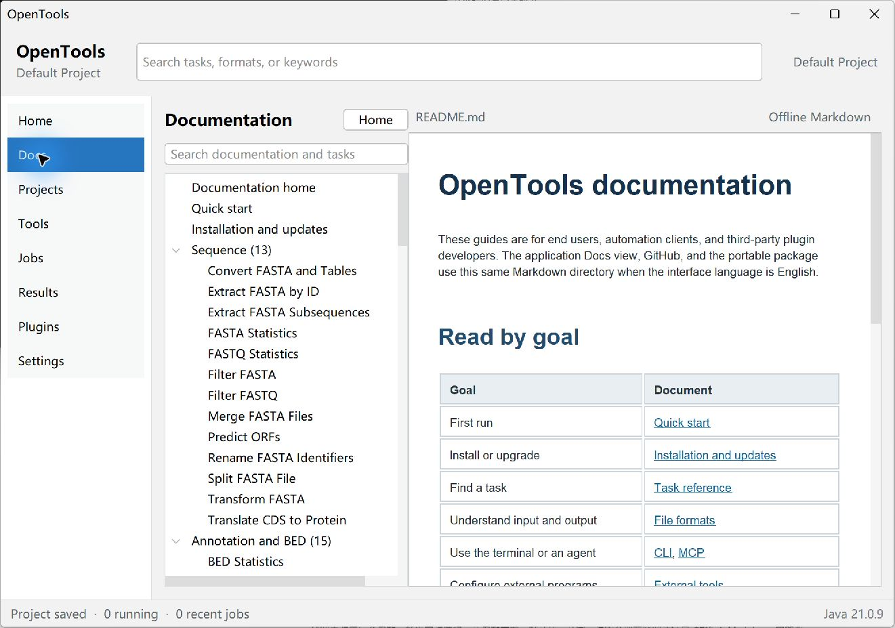
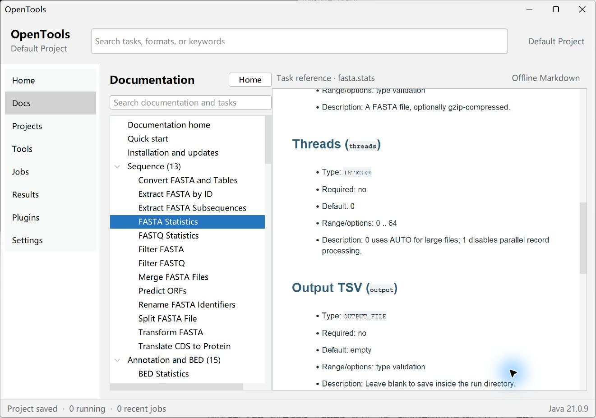

# UI and Docs development

The in-app Docs view is a first-class Swing page. It uses a scrollable tree for
categories and all built-in tools on the left and a bounded Markdown reader on
the right.

## Language-aware resources

Docs resolves its resource root from the active UI language:

```text
docs/en_US/README.md
docs/zh_CN/README.md
```

Every language directory contains its own relative document links, categories,
and screenshots. Switching language in Settings updates the language manager and
rebuilds the main window in the same process. The process is not restarted.

## Rendering contract

- Markdown is parsed locally into a limited Swing HTML subset.
- Raw HTML is escaped.
- Scripts, `javascript:`, absolute paths, remote images, file URLs, and `..`
  path segments are not activated.
- Local links switch documents inside Docs; HTTP(S) links open in the system
  browser.
- Heading IDs provide anchors and duplicate headings get stable suffixes.
- Tool parameter tables come from `ToolDescriptor` and active language keys.
- Tool guides can be discovered from
  `tool/<Tool ID>.md`; plugin guides use the same layout under
  `META-INF/opentools/docs/<language>/` in the plugin JAR.
- A discovered guide is shown first, followed by a separator and the generated
  descriptor reference.
- A missing custom-language guide falls back explicitly to English.

## Visual validation

These screenshots come from the packaged Windows application.





Checks cover the normal workbench, a wide layout, a long tool directory, resizing,
embedded images, and 150% application scaling. The tree scrolls independently and
the article wraps without overlapping controls.

## Test expectations

- both language roots contain every public guide and local asset;
- every local Markdown link resolves;
- unsafe links and remote images are rejected;
- all 86 tools have generated pages;
- custom host and plugin tool guides are discovered without registration;
- custom Markdown and generated reference sections render together;
- navigation counts remain complete;
- Docs and screenshots exist in the application JAR and portable ZIP;
- rendering never requires a network connection.
