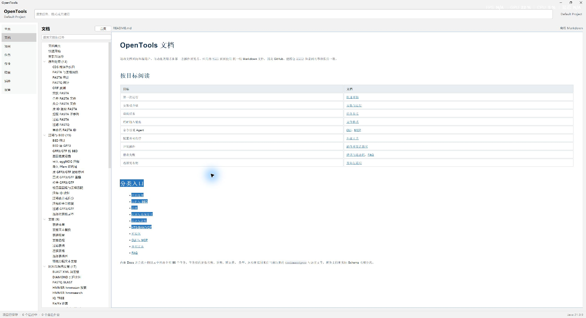
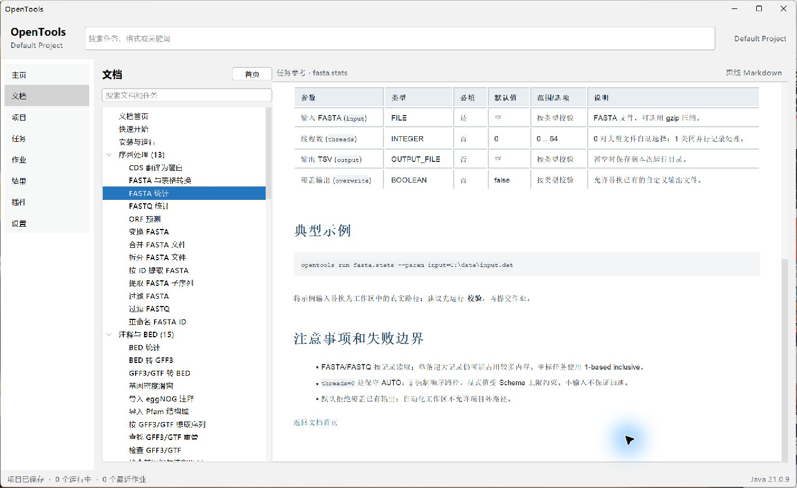
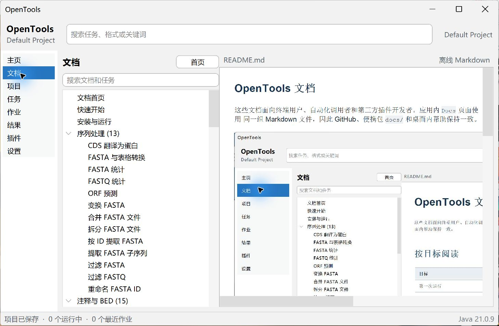

# UI 与 Docs 开发

应用内 `Docs` 是一级 Swing 页面。左侧目录树支持滚动，包含分类和全部内置工具；
右侧是受限的 Markdown 阅读区。

## 多语言资源

Docs 根据当前界面语言选择资源根目录：

```text
docs/zh_CN/README.md
docs/en_US/README.md
```

每种语言目录都包含自己的相对链接、分类页和截图。在设置页选择语言后，应用会
立即更新语言管理器并在同一进程中重建主窗口，不重启 Java 进程。

## 渲染规则

- Markdown 在本地解析为受限的 Swing HTML 子集。
- 原始 HTML 只作为文本显示。
- 脚本、`javascript:`、绝对路径、远程图片、文件 URL 和 `..` 路径不会生效。
- 本地链接在 Docs 页面内切换；HTTP(S) 链接交给系统浏览器。
- 标题生成锚点，重复标题获得稳定后缀。
- 工具参数表来自 `ToolDescriptor` 与当前语言键。
- 工具指南可从 `tool/<Tool ID>.md` 发现；插件指南使用插件 JAR 中
  `META-INF/opentools/docs/<语言>/` 下的相同目录结构。
- 找到自定义指南时先显示指南内容，再显示分隔线和自动生成的 descriptor 参考。
- 没有随包指南的自定义语言会明确回退到英文。

## 视觉验证

以下截图来自实际 Windows 便携包，不是设计稿：







检查覆盖常规窗口、宽屏、长工具目录、窗口缩放、图片渲染和 150% 应用缩放。
目录树独立滚动，正文在右侧自动换行，不与控件重叠。

## 测试范围

- 两种语言目录都包含全部公开指南与本地资源；
- 所有本地 Markdown 链接可解析；
- 不安全链接与远程图片被拒绝；
- 88 个工具都有生成页面；
- 无需注册即可发现宿主和插件自定义工具指南；
- 自定义 Markdown 与自动参考能够组合渲染；
- 导航数量和源分类完整；
- JAR 与便携 ZIP 内确有文档和截图；
- Docs 渲染完全不需要网络。
